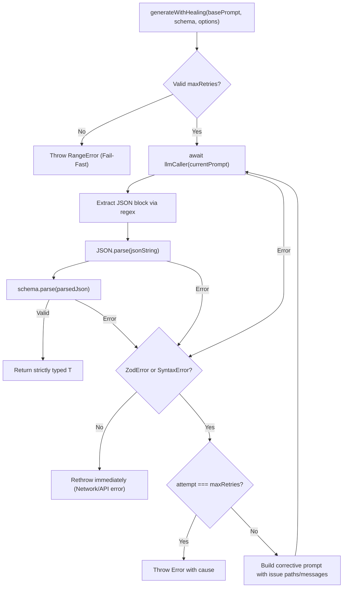

# LLM Schema Guardian

A zero-framework TypeScript utility that enforces strict runtime JSON contracts on Large Language Model (LLM) outputs using [Zod v4](https://zod.dev/) and an automated retry feedback loop (**Auto-Healing**).

When an LLM returns malformed JSON or violates the expected schema, `generateWithHealing` extracts the exact parse or validation diagnostics, injects them into a corrective prompt, and retries until the output matches the schema or `maxRetries` is exhausted.

---

## Why This Exists

Integrating LLMs into production backends, ETL pipelines, or typed frontends introduces failure modes that static types alone cannot catch:

- **Markdown / Prose Pollution:** Models wrap JSON inside `` ```json `` fences or explanatory text.
- **Schema Drift:** Missing required keys, invalid enum values, or type mismatches (e.g., `"29"` instead of `29`).
- **Malformed Syntax:** Trailing commas, truncated payloads, or unquoted keys that break `JSON.parse`.

Instead of crashing downstream services or silently accepting invalid payloads, LLM Schema Guardian isolates validation and recovery at the LLM boundary.

---

## Architecture & Execution Flow



### Key Design Decisions
- **Provider-Agnostic Dependency Injection:** Pass any async `(prompt: string) => Promise<string>` adapter (Google Gemini, OpenAI, Anthropic, local models, or raw `fetch`). Zero SDK lock-in.
- **Fail-Fast Error Classification:** Only healable output defects (`ZodError` and `SyntaxError`) trigger retries. Network timeouts, rate limits, and auth errors rethrow immediately without being masked by `maxRetries`.
- **Error Cause Preservation:** Exhausting retries throws a contextual `Error` carrying the original `ZodError` or `SyntaxError` on `error.cause`.
- **Zod v4 Compatible:** Formats `ZodError.issues` with safe `PropertyKey` serialization (`issue.path.map(String).join('.')`), falling back to `'(root)'` for root-level errors.
- **Decoupled Logging:** Logging is decoupled via an optional `onRetry` callback instead of hardcoded `console.warn`.

---

## Quick Start

```typescript
import { z } from 'zod'
import { generateWithHealing } from './src/guardian'

const UserProfileSchema = z.object({
	name: z.string().min(1),
	age: z.number().int().min(18),
	skills: z.array(z.string()).min(1)
})

// Simulated LLM client: attempt 1 returns invalid types wrapped in markdown;
// attempt 2 self-corrects after receiving the injected Zod issue feedback.
let attempt = 0
const mockLlmCall = async (_prompt: string): Promise<string> => {
	attempt++
	if (attempt === 1) {
		return '```json\n{"name": "Facundo", "age": "29", "skills": "TypeScript, Node"}\n```'
	}
	return '```json\n{"name": "Facundo", "age": 29, "skills": ["TypeScript", "Node"]}\n```'
}

async function main() {
	const profile = await generateWithHealing(
		'Extract the user profile as JSON.',
		UserProfileSchema,
		{
			llmCaller: mockLlmCall,
			maxRetries: 2
		}
	)

	// Inferred type: { name: string; age: number; skills: string[] }
	console.log(profile.skills.map(skill => skill.toUpperCase()))
}

main().catch(error => {
	console.error('Schema validation failed:', error)
})
```

---

## API Reference

### `generateWithHealing<T>(basePrompt, schema, options): Promise<T>`

| Parameter | Type | Description |
| :--- | :--- | :--- |
| `basePrompt` | `string` | Initial instruction sent to the LLM. Preserved as the base for every healing retry. |
| `schema` | `z.ZodType<T>` | Zod schema defining the required output contract and inferred return type `T`. |
| `options` | `GuardianOptions` | Configuration object for the LLM adapter and retry budget. |

### `GuardianOptions`

| Property | Type | Default | Description |
| :--- | :--- | :--- | :--- |
| `llmCaller` | `(prompt: string) => Promise<string>` | *Required* | Async function that invokes the underlying LLM and returns raw text. |
| `maxRetries` | `number` | `2` | Maximum number of healing retries after the initial attempt (`maxRetries + 1` total calls). Must be a non-negative integer. |
| `onRetry` | `(attempt: number, error: ZodError \| SyntaxError) => void` | `undefined` | Optional lifecycle callback invoked on each retry before constructing the healing prompt. |

### Error Contract

| Condition | Behavior |
| :--- | :--- |
| `maxRetries` is negative, float, `NaN`, or `Infinity` | Throws `RangeError` before calling `llmCaller`. |
| `SyntaxError` from `JSON.parse` | Retries with an explicit JSON-only instruction until `maxRetries` is reached. |
| `ZodError` from `schema.parse` | Retries with formatted `path: message` validation issues until `maxRetries` is reached. |
| Any other error (network, timeout, HTTP 5xx, auth) | Rethrows the original error immediately without retrying. |
| Retries exhausted | Throws `Error` with the last `ZodError` or `SyntaxError` attached as `error.cause`. |

---

## Installation & Verification

```bash
npm install
```

Run the test suite and strict TypeScript check:

```bash
# Run all unit and smoke tests (Vitest)
npm test

# Run suites independently
npm run test:unit
npm run test:smoke

# Strict typecheck across source and tests
npm run typecheck
```

---

## Project Structure

```text
llm-schema-guardian/
├── src/
│   └── guardian.ts                # Core auto-healing loop & error boundary
├── tests/
│   ├── unit/
│   │   └── guardian.test.ts       # Isolated unit tests (mocks, edge cases, error contracts)
│   └── smoke/
│       └── guardian.smoke.test.ts # Multi-step end-to-end recovery flow
└── package.json
```

---

## Trade-offs & Production Considerations

- **Greedy Regex Extraction:** Extraction uses `/\{[\s\S]*\}|\[[\s\S]*\]/`, which handles markdown fences and leading/trailing prose well, but can capture extraneous characters if prose outside the JSON contains unbalanced braces. In high-volume production systems, combine this wrapper with provider-native Structured Outputs / JSON mode when available.
- **Latency & Token Budget:** Each healing retry incurs an additional round-trip and prompt tokens. Keep `maxRetries` low (`1`–`2`) for latency-sensitive endpoints.
- **Stateless Retries:** Each corrective prompt rebuilds from `basePrompt` plus the latest validation errors rather than accumulating full conversation history, bounding token growth across retries.

---

## Tech Stack & Patterns

- **Language:** TypeScript (strict mode, generics, schema-driven type inference)
- **Runtime Validation:** Zod v4
- **Testing:** Vitest (unit + smoke test separation)
- **Patterns:** Dependency Injection, Fail-Fast Validation, Error Chaining (`Error.cause`), Agentic Feedback Loop

---

## License

[MIT](LICENSE) © 2026 Facundo Vergara

